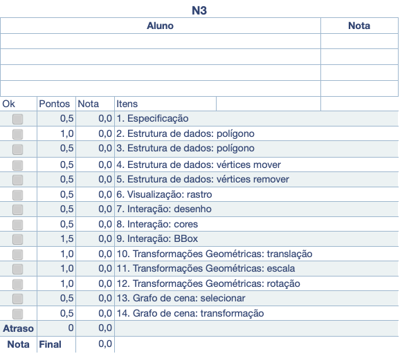

# Unidade 3: Conceitos Básicos - atividade

[CSharp to PlantUML]: https://marketplace.visualstudio.com/items?itemName=pierre3.csharp-to-plantuml
[PlantUML]: https://marketplace.visualstudio.com/items?itemName=jebbs.plantuml

Lembretes:

- Todas as questões deste trabalho devem ser desenvolvidas para serem executadas em um **único** projeto.
- Obrigatoriamente, devem ser usadas as classes disponibilizadas na Unidade 2, juntamente com as que foram criadas nesta unidade em [CG_N3_Exemplo](../CG_N3_Exemplo/).
- Use a pasta **Unidade3** do GitHub da sua equipe para desenvolver e entregar o código.

Para saber como deve ser o resultado, veja o código correspondente ao seu sistema operacional:

- [Linux x64](./CG_N3/CG_N3_linux-x64.zip "CG_N3 para Linux x64");
- [macOS ARM64](./CG_N3/CG_N3_osx-arm64.zip "CG_N3 para macOS ARM64");
- [Windows x64](./CG_N3/CG_N3_win-x64.zip "CG_N3 para Windows x64").

## O que deve ser feito

O cenário consiste em implementar um Editor Vetorial 2D para adicionar e manipular polígonos abertos ou fechados e convexos ou côncavos, utilizando somente o teclado e o mouse.

Conhecimento necessário:  

- estruturas dinâmicas simples para armazenar os dados gráficos;
- algoritmo de seleção: selecionar polígonos côncavos (não entrelaçados);
- transformações geométricas 2D: movimentar, girar e redimensionar objetos;
- conceitos básicos de grafo de cena.

Descrição: o cenário consiste em implementar um Editor Vetorial 2D para adicionar e manipular polígonos abertos ou fechados e convexos ou côncavos, utilizando somente o teclado e o mouse com a biblioteca OpenGL/OpenTK. A aplicação deve permitir adicionar interativamente (clicando na tela) polígonos sem limite de quantidade ou de número de vértices. Além disso, cada polígono pode ter sua própria cor, e deve ser possível apagar ou mover vértices e polígonos. Essas funções devem ser interativas (o usuário deve clicar no polígono ou no vértice).

Observação: as funções `glTranslate`, `glRotate` e `glScale` do OpenGL/OpenTK não devem ser utilizadas para realizar as transformações geométricas. Em vez disso, deve ser usada a classe `Transformacao4D` associada ao objeto gráfico. Assim, o método de desenho do objeto gráfico utiliza `Transformacao4D` juntamente com as funções `glPushMatrix`, `glMultMatrixd` e `glPopMatrix` do OpenGL/OpenTK. A justificativa é que, dessa forma, isola-se a renderização do OpenGL/OpenTK, facilitando, se for o caso, a mudança para outra forma de renderização (por exemplo, DirectX). Para evitar problemas com diferenças entre os valores das coordenadas de tela e do espaço gráfico, não altere os valores usados no `Ortho` do exemplo fornecido. Observe que, após mover os objetos gráficos usando a matriz de transformação do referido objeto, não é possível simplesmente selecionar o objeto usando os seus vértices originais. É necessário obter os valores das coordenadas de tela (dos pixels), convertê-los para o espaço gráfico (do `Ortho`, se for o caso) e, depois, para o espaço do objeto gráfico transformado, usando as matrizes de transformação do grafo de cena até chegar ao objeto desejado.

**ATENÇÃO:** o Editor Vetorial 2D não considera os objetos como pontos, ou seja, qualquer objeto deve sempre ter, no mínimo, dois vértices.

## 1. Especificação

\[Peso 0,5] Especifique as classes, os métodos e os atributos usando um diagrama de classes.
  
Se quiserem, podem usar as extensões:  
[CSharp to PlantUML](https://marketplace.visualstudio.com/items?itemName=pierre3.csharp-to-plantuml)  
[PlantUML](https://marketplace.visualstudio.com/items?itemName=jebbs.plantuml)  
  
A extensão [CSharp to PlantUML] gera a pasta `plantuml` com os arquivos `*.puml` para cada classe dos arquivos-fonte do projeto. Os arquivos `*.puml` contêm uma descrição textual da diagramação da referida classe.
Já a extensão [PlantUML] permite gerar os diagramas dos arquivos `*.puml` no formato SVG (pasta `svg`).
Para saber mais sobre o PlantUML, consulte <https://plantuml.com/>.

## 2. Estrutura de dados: polígono - adicionar

\[Peso 1,0] Utilize o mouse para clicar na tela com o botão direito e desenhar um novo polígono.
Ao pressionar a tecla Enter, finalize o desenho do novo polígono.

## 3. Estrutura de dados: polígono - remover

\[Peso 0,5] Utilize a tecla D para remover o polígono selecionado.  

## 4. Estrutura de dados: vértices mover

\[Peso 0,5] Utilize a posição do mouse e a tecla V para mover o vértice mais próximo do polígono selecionado.

Atenção: ao mover o vértice, os valores das coordenadas são alterados, mas os valores da matriz de transformação não são.

## 5. Estrutura de dados: vértices remover

\[Peso 0,5] Utilize a tecla E para remover o vértice do polígono selecionado mais próximo do ponto do mouse.  

Atenção: ao remover o vértice, os valores das coordenadas são alterados, mas os valores da matriz de transformação não são.

## 6. Visualização: rastro

\[Peso 0,5] Exiba o “rastro” ao desenhar os segmentos do polígono.

## 7. Interação: desenho

\[Peso 0,5] Utilize a tecla P para poder mudar o polígono selecionado para aberto ou fechado.  

## 8. Interação: cores

\[Peso 0,5] Utilize o teclado (teclas R = vermelho, G = verde e B = azul) para trocar as cores do polígono selecionado.

## 9. Interação: BBox

\[Peso 1,5] Utilize o mouse para clicar na tela com o botão esquerdo e selecionar o polígono, testando primeiro se o ponto do mouse está dentro da BBox do polígono e, depois, usando o algoritmo Scan Line.
Caso o polígono seja selecionado, deve-se exibir a sua BBox. Caso contrário, a variável `objetoSelecionado` deve ser `null` e nenhum contorno de BBox deve ser exibido.

## 10. Transformações Geométricas: translação

\[Peso 1,0] Utilizando as teclas das setas direcionais (cima, baixo, direita e esquerda), movimente o polígono selecionado.

Atenção: use a matriz de transformação e não altere os valores dos vértices dos polígonos.

[Conteúdo](../README.md#translação-homogênea-3d-origem)  

## 11. Transformações Geométricas: escala

\[Peso 1,0] Utilizando as teclas Home/End, redimensione o polígono selecionado em relação ao centro da sua BBox.

Atenção: use a matriz de transformação e não altere os valores dos vértices dos polígonos.

[Conteúdo](../README.md#escala-homogênea-3d-origem)  

## 12. Transformações Geométricas: rotação

\[Peso 1,0] Utilizando as teclas numéricas 3 e 4, gire o polígono selecionado em relação ao centro da sua BBox.

Atenção: use a matriz de transformação e não altere os valores dos vértices dos polígonos.

[Conteúdo](../README.md#rotação-homogênea-3d-origem)  

## 13. Grafo de cena: selecionar

\[Peso 0,5] Permita adicionar polígonos “filhos” a um polígono selecionado utilizando a estrutura do grafo de cena.

Atenção: use a matriz de transformação global para acumular transformações de acordo com o grafo de cena.

[Conteúdo](../README.md#grafo-de-cena)  

## 14. Grafo de cena: transformação

\[Peso 0,5] Considere a transformação global ao transformar (translação/escala/rotação) um polígono “pai”.  

Atenção: use a matriz de transformação global para acumular transformações de acordo com o grafo de cena.

[Conteúdo](../README.md#grafo-de-cena)  

## Atenção

A avaliação da atividade envolve o desenvolvimento das questões apresentadas acima, mas o mais importante é que cada integrante da equipe demonstre conhecimento não apenas sobre o código desenvolvido, mas também sobre os conceitos apresentados em aula relacionados à atividade.

## Gabarito

  

----

## ⏭ [Unidade 4](../../Unidade4/README.md "Unidade 4")
