# Computação Gráfica - Unidade 3  

[VisEdu-CG]: <https://gcgfurb.github.io/yoda/> "VisEdu-CG"  

Interface, transformações 2D e seleção. Programação orientada a eventos. Elementos de interface, eventos e atributos de elementos de interface. Funções de callback (teclado e mouse). Transformações de sistemas de coordenadas. Transformações geométricas 2D, algoritmos de seleção e Bounding Box.

Objetivo: demonstrar conhecimento no desenvolvimento de sistemas com interface gráfica para o usuário. Interpretar, especificar e desenvolver aplicações simples com transformações geométricas.

## [Atividades - Aula](./Atividade3/README.md "Atividades - Aula")

## Rabiscos

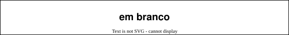

## Material  

### Algoritmo de Seleção

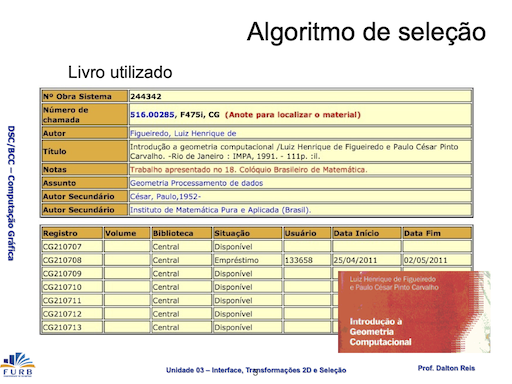
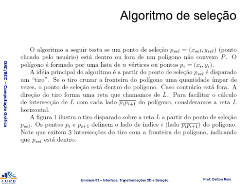
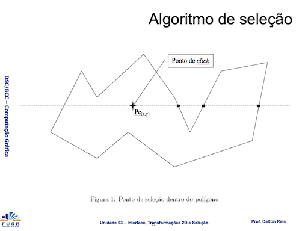
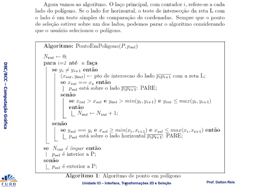
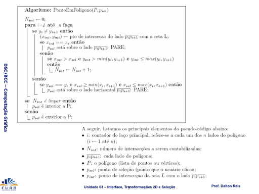
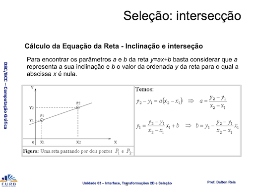
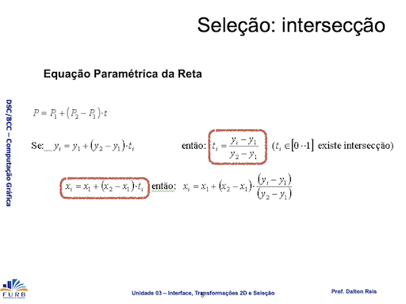
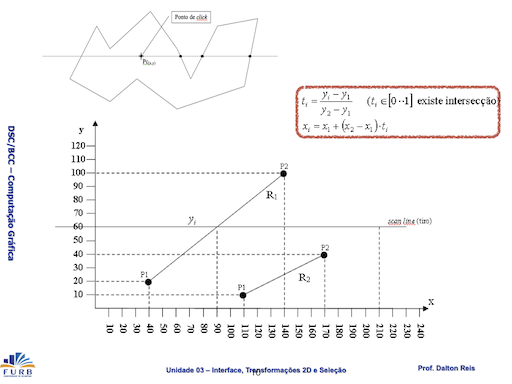
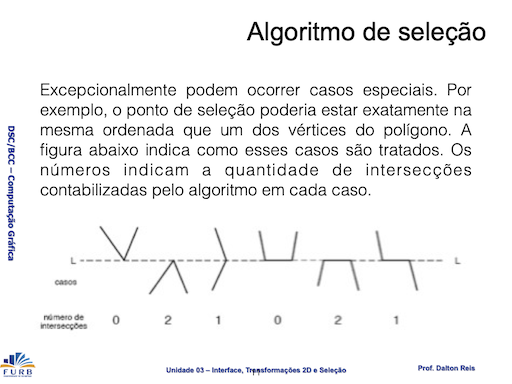

----

### [VisEdu-CG]  

----

### Grafo de Cena

Cena:  

- representação abstrata de todos os componentes que são apresentados em um mundo virtual;  
- todo componente que será representado no ambiente e exercerá um comportamento que afeta outros componentes deverá ser anexado a um nó de cena dentro de uma hierarquia.

Componentes:  

- Objetos Gráficos;  
- Iluminação;  
- Câmera;  
- etc.  

Grafo de Cena:  

- estrutura composta por arcos e nós, em forma de árvore, utilizada para especificar e documentar programas que representam uma cena gráfica;  
- composto por um conjunto de símbolos que representam instâncias de objetos de classes específicas.  

São estruturas de dados organizadas por meio de classes nas quais, mediante uma hierarquia de objetos e atributos, pode-se especificar cenas complexas com mais facilidade. Cada objeto ou atributo é representado por uma classe que possui informações sobre sua aparência física, entre outros fatores. Um grafo de cena trata problemas que geralmente surgem em composições ou gerenciamentos de cenas (POZZER, 2007).
Popularizado pelo SGI Open Inventor, o grafo de cena evita que o desenvolvedor tenha de se preocupar com os detalhes que compõem a renderização, permitindo que ele se concentre nos objetos que deseja renderizar, em vez de se preocupar com a lógica da renderização em si (WALSH, 2002).

Conforme Silva, Raposo e Gattas (2004, p. 3)[^2], “\[...] grafos de cena são ferramentas conceituais para representação de ambientes virtuais tridimensionais nas aplicações de computação gráfica”. Isso significa que o grafo é uma espécie de mapa para a cena construída, mostrando quais objetos gráficos fazem parte dela, quais objetos possuem filhos e quais são as suas características (cor, textura, posicionamento etc.). Azevedo, Conci e Vasconcelos (2022, p. 183)[^1] também afirmam que “\[...] é comum que os objetos sejam descritos como malhas poligonais, compostas por conjuntos de vértices e arestas”. Sendo assim, objetos gráficos são formas compostas por coordenadas mapeadas e representadas no mundo gráfico.

<!--
-->

#### Simbologia  

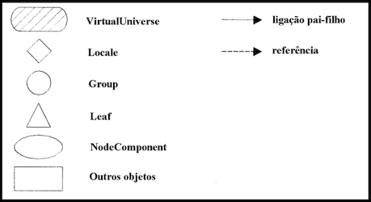  

#### Formalismo  

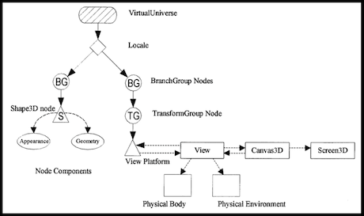  

#### Especificação de um Ambiente Gráfico  

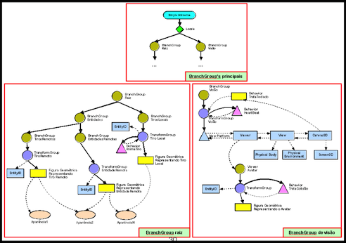  

#### Grafo de Cena: Transformações geométricas

- OpenGL não implementa o grafo de cena;
- Grafo de cena: estrutura a cena, facilitando o processamento gráfico;
- Estrutura básica:  
  - Mundo (com lista de objetos gráficos)  
  - Objeto gráfico  
    - Forma: geometria e topologia  
    - Aparência: cor, material etc.
    - Boundary box  
    - Transformações geométricas  
    - Objetos "filhos": novos objetos gráficos (herdam transformações do pai).

### Transformações Geométricas  

As transformações geométricas (translação, escala e rotação) do ponto médio demonstram que qualquer segmento de reta pode ser transladado, escalado e rotacionado pela simples transformação de seus pontos extremos.
Observação: as transformações são sempre em relação à origem.  

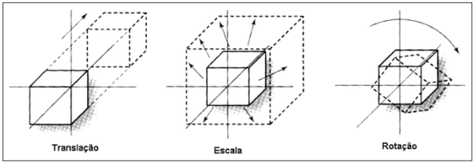  

> \[!IMPORTANT]
>
> As transformações de translação, escala e rotação utilizam as operações de soma, multiplicação e seno/cosseno, respectivamente. Porém, não são operações aritméticas, e sim geométricas. No caso de transformações geométricas homogêneas, utilizam-se **matrizes** para realizar essas operações. A matriz tem a dimensão do espaço gráfico $(x,y,z)$ acrescida de uma dimensão, que corresponde ao espaço homogêneo. Para realizar uma transformação (translação, escala ou rotação), **multiplica-se** um ponto por essa matriz.

<https://github.com/dalton-reis/disciplina_CG_2026-2_not/tree/main/CG_Biblioteca/Transformacao4D.cs#L11-L15>

#### Matriz: propriedades

- deve-se respeitar a regra das dimensões para poder multiplicar matrizes entre si.

[Exemplo de Multiplicação de Matrizes](https://www.geogebra.org/m/ETHXK756)  

##### Matriz Identidade

A matriz $identidade$ é o elemento neutro na multiplicação de matrizes.

```math
\begin{bmatrix}
   a &  e & i & m \\
   b &  f & j & n \\
   c &  g & k & o \\
   d &  h & l & p
 \end{bmatrix}
\times
\begin{bmatrix}
  1 & 0 & 0 & 0 \\
  0 & 1 & 0 & 0 \\
  0 & 0 & 1 & 0 \\
  0 & 0 & 0 & 1
 \end{bmatrix}
 =
\begin{bmatrix}
   a &  e & i & m \\
   b &  f & j & n \\
   c &  g & k & o \\
   d &  h & l & p
 \end{bmatrix}
```

<https://github.com/dalton-reis/disciplina_CG_2026-2_not/tree/main/CG_Biblioteca/Transformacao4D.cs#L71-L78>

#### Translação homogênea 3D: origem

> \[!WARNING]
> Esta transformação é em relação à origem do sistema de referência.

A translação de um ponto $P(x,y,z)$ no plano ocorre pela adição dos valores de deslocamento $dx$, $dy$ e $dz$ às coordenadas de $P$. Como se trata de uma adição, o elemento neutro é zero.

| Transformação | operação          | elemento neutro                      |
| ------------- | ----------------- | ------------------------------------ |
| Translação    | soma              | 0                                    |

##### Translação: Expressão

```math
P(x,y,z) \Rightarrow P(x',y',z')
\space\space\space\space\space\space
\begin{matrix}
x + dx = x' \\
y + dy = y' \\
z + dz = z'
\end{matrix}
```

##### Translação: Matriz

```math
\begin{bmatrix}
  x \space y \space z
\end{bmatrix}
+
\begin{bmatrix}
  dx \space dy \space dz
\end{bmatrix}
=
\begin{bmatrix}
  x' \space y' \space z'
\end{bmatrix}
```

##### Translação: Matriz Homogênea

```math
\begin{bmatrix}
  x \\
  y \\
  z \\
  1
\end{bmatrix}
\times
\begin{bmatrix}
  1 & 0 & 0 & \textcolor{red}{dx} \\
  0 & 1 & 0 & \textcolor{red}{dy} \\
  0 & 0 & 1 & \textcolor{red}{dz} \\
  0 & 0 & 0 & 1
 \end{bmatrix}
 =
 \begin{bmatrix}
  x' \\
  y' \\
  z' \\
  1
\end{bmatrix}
\space\space\space\space\space\space\space\space\space\space\space\space\space\space\space
\begin{bmatrix}
   0 &  4 &  8 & \textcolor{red}{12} \\
   1 &  5 &  9 & \textcolor{red}{13} \\
   2 &  6 & 10 & \textcolor{red}{14} \\
   3 &  7 & 11 & 15
 \end{bmatrix}
```

<https://github.com/dalton-reis/disciplina_CG_2026-2_not/tree/main/CG_Biblioteca/Transformacao4D.cs#L82-L88>

#### Escala homogênea 3D: origem

> \[!WARNING]
> Esta transformação é em relação à origem do sistema de referência.

A escala de um ponto $P(x,y,z)$ no plano ocorre pela multiplicação das coordenadas de $P$ pelos valores de escala $sx$, $sy$ e $sz$. Como se trata de uma multiplicação, o elemento neutro é um.

| Transformação | operação          | elemento neutro                      |
| ------------- | ----------------- | ------------------------------------ |
| escala        | multiplicação     | 1                                    |

Fator de escala > 1 amplia  
Fator de escala no intervalo ]0..1\[ reduz  

##### Escala: Expressão

```math
P(x,y,z) \Rightarrow P(x',y',z')
\space\space\space\space\space\space
\begin{matrix}
x \times sx = x' \\
y \times sy = y' \\
z \times sz = z'
\end{matrix}
```

##### Escala: Matriz

```math
\begin{bmatrix}
  x \\
  y \\
  z
\end{bmatrix}
\times
\begin{bmatrix}
  \textcolor{red}{sx} & 0 & 0 \\
  0 & \textcolor{red}{sy} & 0 \\
  0 & 0 & \textcolor{red}{sz}
 \end{bmatrix}
=
\begin{bmatrix}
  x' \\
  y' \\
  z'
\end{bmatrix}
```

##### Escala: Matriz Homogênea

```math
\begin{bmatrix}
  x \\
  y \\
  z \\
  1
\end{bmatrix}
\times
\begin{bmatrix}
  \textcolor{red}{sx} & 0 & 0 & 0 \\
  0 & \textcolor{red}{sy} & 0 & 0 \\
  0 & 0 & \textcolor{red}{sz} & 0 \\
  0 & 0 & 0 & 1
 \end{bmatrix}
 =
 \begin{bmatrix}
  x' \\
  y' \\
  z' \\
  1
\end{bmatrix}
\space\space\space\space\space\space\space\space\space\space\space\space\space\space\space
\begin{bmatrix}
   \textcolor{red}{0} &  4 &  8 & 12 \\
   1 &  \textcolor{red}{5} &  9 & 13 \\
   2 &  6 & \textcolor{red}{10} & 14 \\
   3 &  7 & 11 & 15
 \end{bmatrix}
```

<https://github.com/dalton-reis/disciplina_CG_2026-2_not/tree/main/CG_Biblioteca/Transformacao4D.cs#L93-L99>

#### Rotação homogênea 3D: origem

Sentido anti-horário:  

> \[!WARNING]
> Esta transformação é em relação à origem do sistema de referência.

A rotação de um ponto $P(x,y,z)$ no plano ocorre em relação às dimensões do sistema de referência. No caso de um sistema de referência 3D, as rotações ocorrerão em relação aos eixos $X$, $Y$ e $Z$, definidos pelo ângulo de rotação.

| Transformação | operação          | elemento neutro                      |
| ------------- | ----------------- | ------------------------------------ |
| Rotação       | seno / cosseno    | 0° ou múltiplo de 360°               |

[Como chegar na matriz de Rotação](rotacao.md)  

##### Rotação eixo X: Matriz Homogênea

```math
\begin{bmatrix}
  x \\
  y \\
  z \\
  1
\end{bmatrix}
\times
\begin{bmatrix}
  1 & 0 & 0 & 0 \\
  0 & \textcolor{red}{cos\alpha} & \textcolor{red}{-sin\alpha} & 0 \\
  0 & \textcolor{red}{sin\alpha} & \textcolor{red}{cos\alpha} & 0 \\
  0 & 0 & 0 & 1
 \end{bmatrix}
 =
 \begin{bmatrix}
  x' \\
  y' \\
  z' \\
  1
\end{bmatrix}
\space\space\space\space\space\space\space\space\space\space\space\space\space\space\space
\begin{bmatrix}
   0 &  4 &  8 & 12 \\
   1 &  \textcolor{red}{5} &  \textcolor{red}{9} & 13 \\
   2 &  \textcolor{red}{6} & \textcolor{red}{10} & 14 \\
   3 &  7 & 11 & 15
 \end{bmatrix}
```

<https://github.com/dalton-reis/disciplina_CG_2026-2_not/tree/main/CG_Biblioteca/Transformacao4D.cs#L103-L110>

##### Rotação eixo Y: Matriz Homogênea

```math
\begin{bmatrix}
  x \\
  y \\
  z \\
  1
\end{bmatrix}
\times
\begin{bmatrix}
  \textcolor{red}{cos\alpha} & 0 & \textcolor{red}{-sin\alpha} & 0 \\
  0 & 1 & 0 & 0 \\
  \textcolor{red}{sin\alpha} & 0 & \textcolor{red}{cos\alpha} & 0 \\
  0 & 0 & 0 & 1
 \end{bmatrix}
 =
 \begin{bmatrix}
  x' \\
  y' \\
  z' \\
  1
\end{bmatrix}
\space\space\space\space\space\space\space\space\space\space\space\space\space\space\space
\begin{bmatrix}
   \textcolor{red}{0} &  4 &  \textcolor{red}{8} & 12 \\
   1 &  5 & 9 & 13 \\
   \textcolor{red}{2} & 6 & \textcolor{red}{10} & 14 \\
   3 &  7 & 11 & 15
 \end{bmatrix}
```

<https://github.com/dalton-reis/disciplina_CG_2026-2_not/tree/main/CG_Biblioteca/Transformacao4D.cs#L114-L121>

##### Rotação eixo Z: Matriz Homogênea

```math
\begin{bmatrix}
  x \\
  y \\
  z \\
  1
\end{bmatrix}
\times
\begin{bmatrix}
  \textcolor{red}{cos\alpha} & \textcolor{red}{-sin\alpha} & 0 & 0\\
  \textcolor{red}{sin\alpha} & \textcolor{red}{cos\alpha} & 0 & 0 \\
  0 & 0 & 1 & 0 \\
  0 & 0 & 0 & 1
 \end{bmatrix}
 =
 \begin{bmatrix}
  x' \\
  y' \\
  z' \\
  1
\end{bmatrix}
\space\space\space\space\space\space\space\space\space\space\space\space\space\space\space
\begin{bmatrix}
   \textcolor{red}{0} & \textcolor{red}{4} & 8 & 12 \\
   \textcolor{red}{1} & \textcolor{red}{5} & 9 & 13 \\
   2 & 6 & 10 & 14 \\
   3 &  7 & 11 & 15
 \end{bmatrix}
```

<https://github.com/dalton-reis/disciplina_CG_2026-2_not/tree/main/CG_Biblioteca/Transformacao4D.cs#L125-L132>

### Composição de Transformações Geométricas  

As transformações de translação, escala e rotação são **independentes** umas das outras. No entanto, é possível multiplicar matrizes de transformação entre si para **acumular** transformações e, assim, reduzir expressivamente o custo das transformações dos pontos de uma cena. Em vez de multiplicar os pontos de uma cena por uma sequência de matrizes de transformação, multiplicam-se essas matrizes entre si, gerando uma **matriz de transformação global**. Depois, os pontos da cena são multiplicados por essa matriz para aplicar as transformações aos objetos.

- A multiplicação de matrizes é associativa, mas não comutativa.

Ordem das transformações: rotação seguida de uma translação  
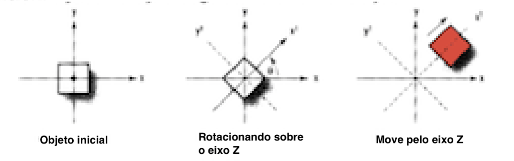

Ordem das transformações: translação seguida de uma rotação  
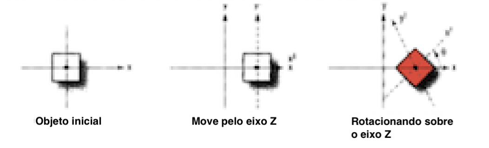

Observe que o resultado final é diferente, ou seja, a ordem das transformações interfere no resultado após uma sequência de transformações. Um caso clássico é a transformação de escala ou rotação em relação a um ponto fixo, na qual se usa a seguinte sequência:

- translação para a origem em relação ao ponto que se quer fixar na transformação;
- a transformação, no caso, escala ou rotação;  
- translação inversa da origem para o ponto que foi fixado na transformação.

A multiplicação de diferentes matrizes de transformação entre si gera a concatenação de todas as modificações em uma única estrutura, chamada de matriz de modelação-visualização. Ela é responsável por determinar, dentro de um contexto, as posições e modificações dos objetos 3D de uma cena.

----

## ⏭ [Unidade 4](../Unidade4/README.md "Unidade 4")  

[^1]: AZEVEDO, Eduardo; CONCI, Aura; VASCONCELOS, Cristina. Computação Gráfica: Teoria e Prática: Geração de Imagens. 1. ed. rev. Rio de Janeiro: Alta Books, 2022.  
[^2]: SILVA, Romano J. M. da; RAPOSO, Alberto B.; GATTAS, Marcelo. Grafo de Cena e Realidade Virtual. Rio de Janeiro: PUC, 2004. Disponível em: <https://web.tecgraf.puc-rio.br/~abraposo/INF1366/2007/02_GrafoDeCena_texto.pdf>. Acesso em: 27 nov. 2023.  

<!--
## Download

Nesta pasta tem um executável da atividade 3 que pode ser usado para ajudar a entender o enunciado desta atividade.  
[CG-N3_Executavel](./CG-N3_Executavel/ "CG-N3_Executavel")  

## Dicas de código

Na Classe Mundo.cs adicione *ToolkitOptions*  

```csharp
  class Program
  {
    static void Main(string[] args)
    {
      ToolkitOptions.Default.EnableHighResolution = false;
      Mundo window = Mundo.GetInstance(600, 600);
      window.Title = "CG_N3";
      window.Run(1.0 / 60.0);
    }
  }
}
```

Já na Classe Objeto.cs o método *Desenhar()*  

```csharp
    public void Desenhar()
    {
#if CG_OpenGL
      GL.PushMatrix();                                    // N3-Exe12: grafo de cena
      GL.MultMatrix(matriz.ObterDados());
      GL.Color3(objetoCor.CorR, objetoCor.CorG, objetoCor.CorB);
      GL.LineWidth(primitivaTamanho);
      GL.PointSize(primitivaTamanho);
#endif
      DesenharGeometria();
      for (var i = 0; i < objetosLista.Count; i++)
      {
        objetosLista[i].Desenhar();
      }
      GL.PopMatrix();                                     // N3-Exe12: grafo de cena
    }
```

E ainda, na Classe Objeto.cs, um exemplo de método para rotação em relação à origem do SRU

```csharp
    public void Rotacao(double angulo)
    {
      RotacaoEixo(angulo);
      matriz = matrizTmpRotacao.MultiplicarMatriz(matriz);
    }

```

Já, na Classe Objeto.cs, um exemplo de método para rotação em torno de um ponto  

```csharp
    public void RotacaoEixo(double angulo)
    {
      switch (eixoRotacao)
      {
        case 'x':
          matrizTmpRotacao.AtribuirRotacaoX(Transformacao4D.DEG_TO_RAD * angulo);
          break;
        case 'y':
          matrizTmpRotacao.AtribuirRotacaoY(Transformacao4D.DEG_TO_RAD * angulo);
          break;
        case 'z':
          matrizTmpRotacao.AtribuirRotacaoZ(Transformacao4D.DEG_TO_RAD * angulo);
          break;
      }
    }
```

```csharp
    public void RotacaoZBBox(double angulo)
    {
      matrizGlobal.AtribuirIdentidade();
      Ponto4D pontoPivo = bBox.obterCentro;

      matrizTmpTranslacao.AtribuirTranslacao(-pontoPivo.X, -pontoPivo.Y, -pontoPivo.Z); // Inverter sinal
      matrizGlobal = matrizTmpTranslacao.MultiplicarMatriz(matrizGlobal);

      RotacaoEixo(angulo);
      matrizGlobal = matrizTmpRotacao.MultiplicarMatriz(matrizGlobal);

      matrizTmpTranslacaoInversa.AtribuirTranslacao(pontoPivo.X, pontoPivo.Y, pontoPivo.Z);
      matrizGlobal = matrizTmpTranslacaoInversa.MultiplicarMatriz(matrizGlobal);

      matriz = matriz.MultiplicarMatriz(matrizGlobal);
    }
```

----------
-->
<!--[ScanLine](./ScanLine.pdf)  -->
<!--[TransformacoesGeometricas](./TransformacoesGeometricas.pdf)  -->
